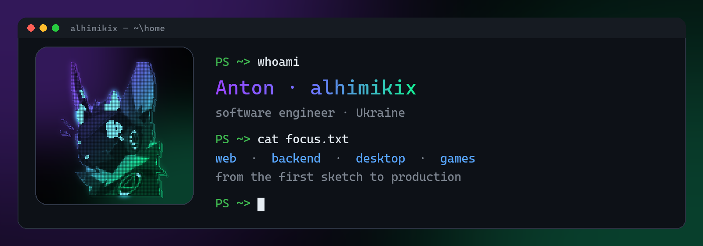

### Hi, I'm Anton 👋

Software engineer from Ukraine. I build fast, reliable software.

### What I work on

- 🌐 **Web** — clean, responsive interfaces that feel quick
- ⚙️ **Backend** — services and APIs that stay up under load
- 🖥️ **Desktop** — native-feeling apps for everyday work
- 🎮 **Games** — gameplay systems and multiplayer servers

### Tech

### Featured

**[solana-vanity-gpu](https://github.com/alhimikix/solana-vanity-gpu)** — GPU vanity address generator: a CUDA app
(~410M keys/sec on an RTX 5080, 6× faster than where it started) and the same pipeline ported to WebGPU, so it also
runs in the browser. **[Try it live →](https://alhimikix.github.io/solana-vanity-gpu/)**
